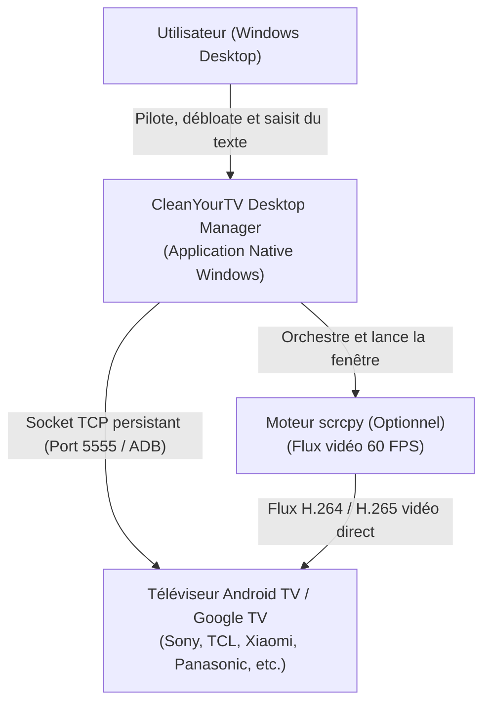
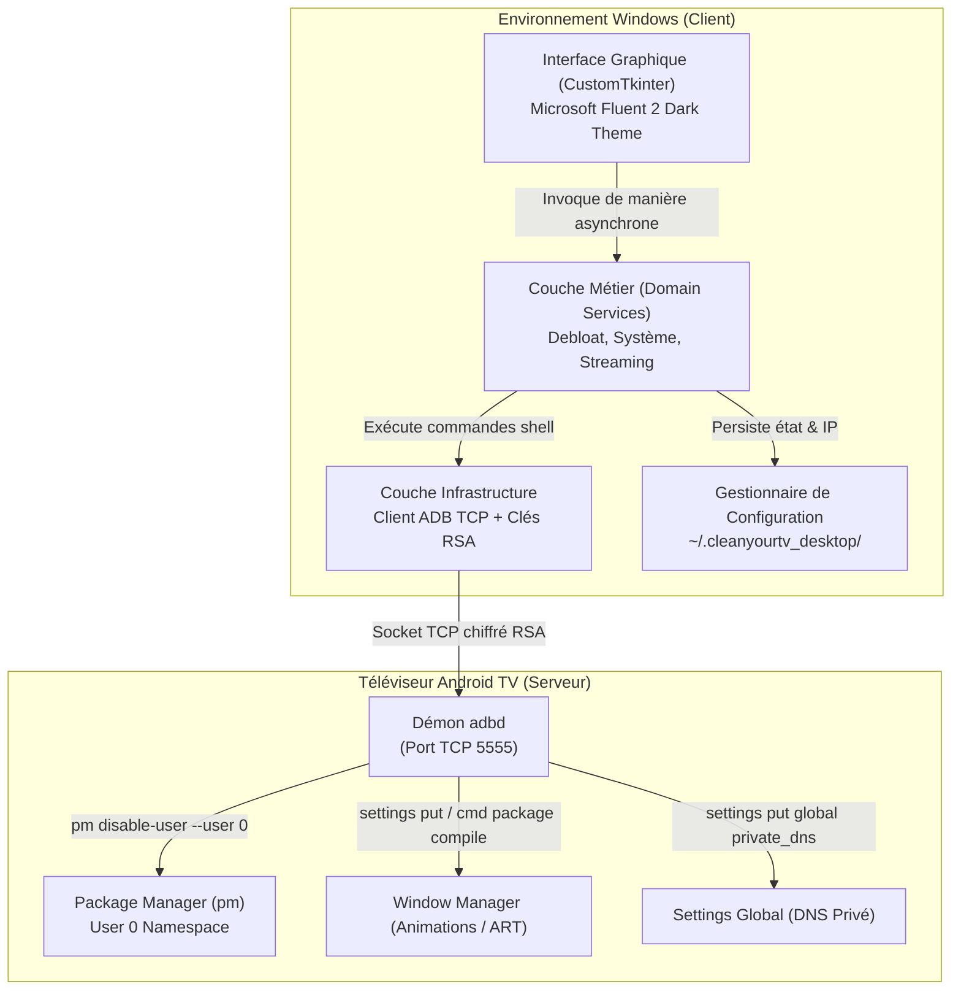
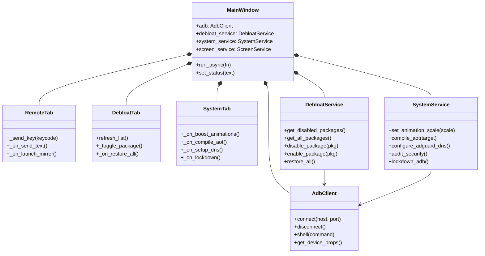
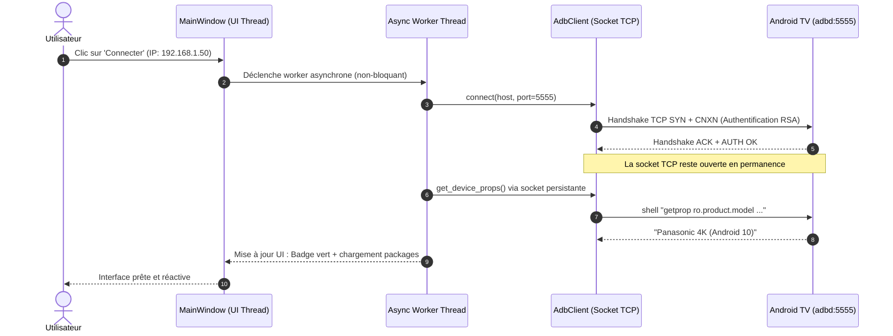

# Architecture Technique & Modèle C4

Ce document détaille l'architecture logicielle de **CleanYourTV Desktop Manager** selon le standard C4 (Contexte, Conteneurs, Composants).

---

## 1. C4 Niveau 1 : Diagramme de Contexte Système

---

## 2. C4 Niveau 2 : Diagramme de Conteneurs

---

## 3. C4 Niveau 3 : Diagramme de Composants Internes

---

## 4. Diagramme de Séquence : Connexion Persistante à Faible Latence (~20ms)

